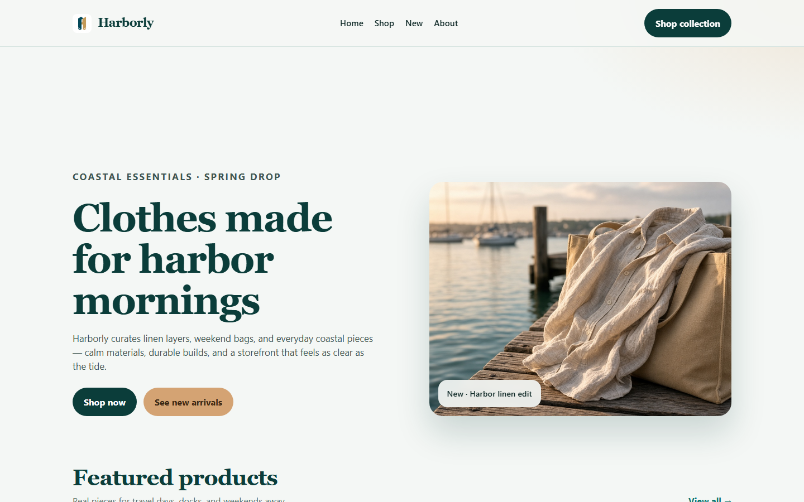
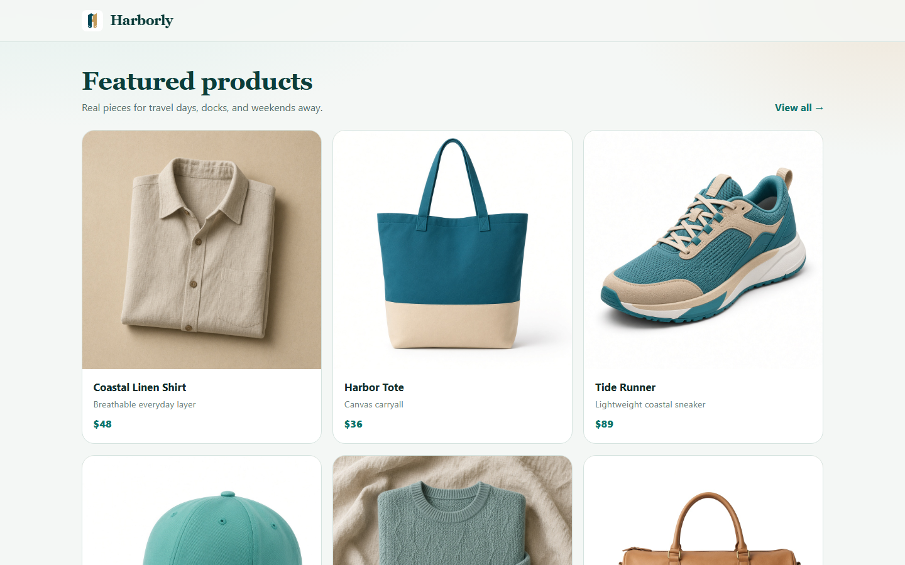
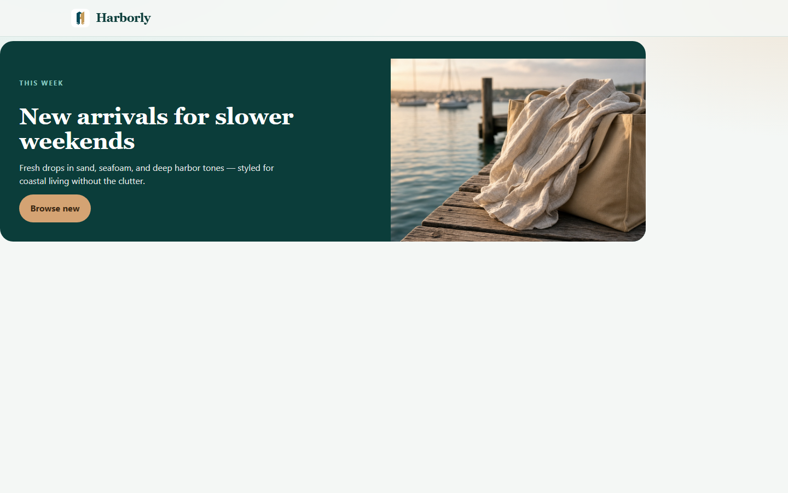
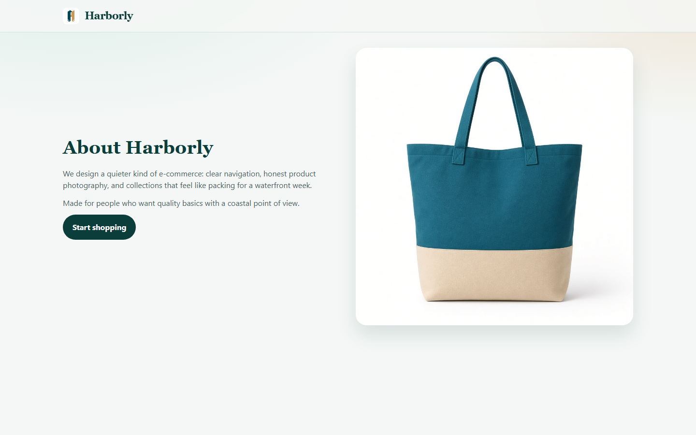

# Harborly

Modern e-commerce storefront with a teal & sand brand system. Includes a static `preview.html` for quick browsing without the full Laravel stack.

## Screenshots

| Home | Shop |
|------|------|
|  |  |

| Campaign | About |
|----------|-------|
|  |  |


## Getting started

**Quick preview**

```bash
npx serve .
```

Then open `/preview.html`.

**Full Laravel / Bagisto**

```bash
composer install
cp .env.example .env
php artisan key:generate
php artisan migrate
php artisan serve
```

Set `APP_NAME=Harborly` in `.env`.

## License

Made by **Tahsan** · [CC BY 4.0](https://creativecommons.org/licenses/by/4.0/)
